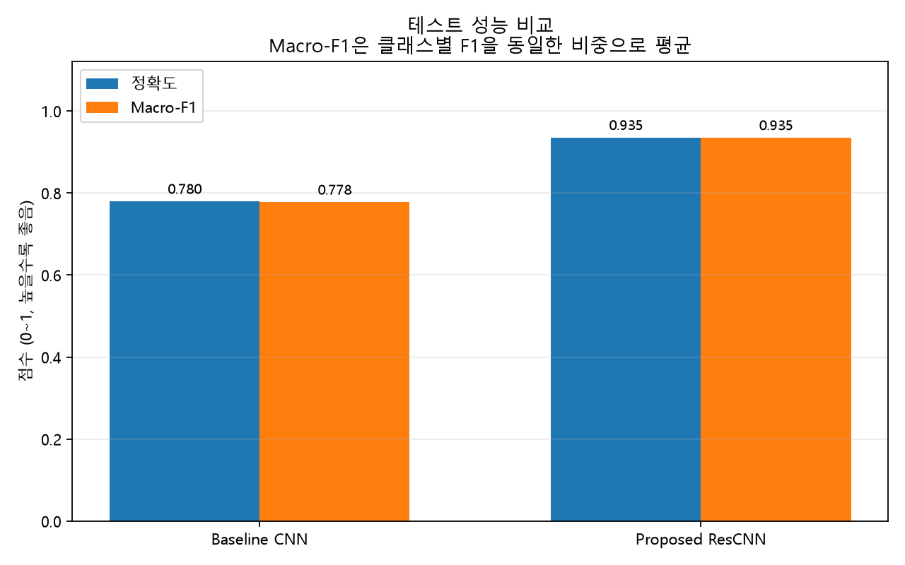
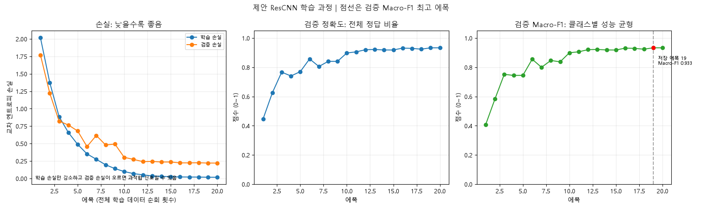
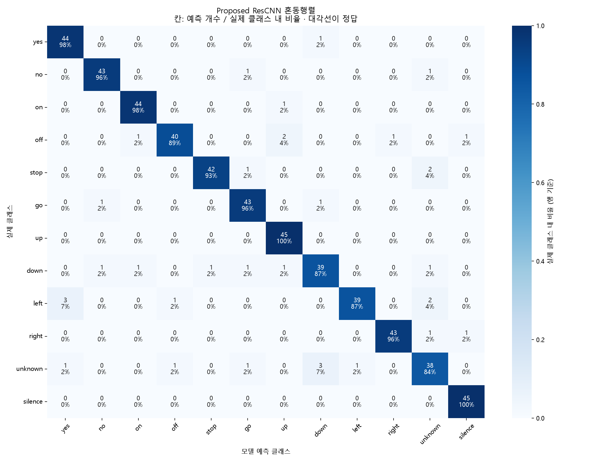

# 스마트 홈 음성 명령 키워드 스포팅 (KWS)

**작성자:** 신의서 (202235271)  
**GitHub:** [US-Shin/ML_Projects_KWS](https://github.com/US-Shin/ML_Projects_KWS)  
**공개 데모 (임시):** [Gradio 공개 데모](https://6d91600116fe8bdd9e.gradio.live)  
이 임시 링크는 앱 프로세스가 실행되는 동안 이용할 수 있고 최대 1주일 후 만료될 수 있습니다. Hugging Face Spaces 영구 배포를 위한 파일도 `deployment/hf_space/`에 준비했습니다.

## 프로젝트 소개

짧은 영어 음성 명령어 10개를 인식해 스마트홈 제어에 활용할 수 있는 키워드 스포팅 시스템입니다. 입력은 1초 길이의 음성 특징으로 변환하며, 마이크 또는 WAV 업로드로 추론할 수 있습니다. 대상 키워드는 `yes`, `no`, `on`, `off`, `stop`, `go`, `up`, `down`, `left`, `right`이고, 추가 클래스 `unknown`, `silence`를 포함해 총 12개 클래스로 분류합니다.

## 데이터와 전처리

- **원본:** [Google Speech Commands v0.02](http://download.tensorflow.org/data/speech_commands_v0.02.tar.gz), TensorFlow 호스팅 다운로드 주소에서 직접 받습니다. Hugging Face 재배포본을 사용한 것이 아닙니다.
- **라이선스:** CC BY 4.0. 원본 데이터의 출처와 저작자 표시 조건을 따릅니다.
- **샘플링:** 전체 105,829개 중 프로젝트에서 선택한 10개 단어는 클래스당 최대 300개를 사용합니다. `unknown`은 그 외 단어에서 샘플링하고 `silence`는 배경 소음 구간으로 만듭니다.
- **특징:** 모노 변환 및 필요 시 16 kHz 리샘플링 후 40개 Mel 필터의 로그 Mel 스펙트로그램을 생성합니다. 길이는 1초로 맞춥니다. 입력 전체를 최대 진폭으로 정규화하지 않아 작은 마이크 잡음이 과도하게 커지는 것을 줄입니다.
- **분할:** 학습/검증/테스트 70/15/15, 계층화 분할, `random_state=42`.

원본 아카이브는 약 2.43 GB이므로 저장소와 제출 ZIP에서 제외했습니다. 실행 시 코드가 다운로드합니다. 저장 위치는 `data/raw/` 및 `data/processed/`입니다.

## 모델 및 결과

두 모델 모두 PyTorch로 처음부터 학습했습니다. 마지막 평가 CSV(`results/model_comparison.csv`) 기준입니다.

| 모델 | 테스트 정확도 | 테스트 Macro-F1 |
|---|---:|---:|
| Baseline CNN | 77.96% | 77.76% |
| Proposed ResCNN | **93.52%** | **93.48%** |

테스트셋에서 제안 ResCNN은 베이스라인보다 정확도와 Macro-F1 모두 높았습니다. Macro-F1은 각 클래스별 F1 점수를 같은 비중으로 평균해, 클래스별 성능 균형을 봅니다. 테스트 결과만으로 실제 마이크·환경 소음에서의 성능까지 보장하지는 않습니다.

### 평가 그래프

**모델 비교**



**제안 모델 학습 곡선**



**제안 모델 혼동행렬**



혼동행렬의 세로축은 실제 클래스, 가로축은 예측 클래스입니다. 대각선은 정답이며, 대각선 밖 숫자는 오분류입니다. 전체 그림 설명은 [`results/시각화_읽는법.md`](results/시각화_읽는법.md)를 참고하세요.

## 데모와 배포

Gradio 앱과 Hugging Face Spaces 배포 파일은 `app/` 및 `deployment/hf_space/`에 있습니다. 현재 임시 공개 링크는 [https://6d91600116fe8bdd9e.gradio.live](https://6d91600116fe8bdd9e.gradio.live)입니다. 이 링크는 앱 프로세스가 실행되는 동안 이용할 수 있고 최대 1주일 후 만료될 수 있으므로 영구 제출 주소로 쓰기에는 제한이 있습니다. Hugging Face Spaces 계정 인증은 설정되어 있지 않아 영구 Space는 아직 생성하지 않았습니다. HF 문서에 따르면 Gradio/Docker Space는 개인 계정 PRO 또는 요건을 충족한 무료 계정의 ZeroGPU 조건이 필요할 수 있습니다. Space를 만들면 보통 `https://<사용자>-<space이름>.hf.space` 형식의 주소를 사용합니다.

### 서비스 화면 캡처

배포 페이지에서 아래 3장을 캡처한 뒤 `screenshots/`의 동일 파일을 교체하세요.

1. 데모 첫 화면: `screenshots/01_demo_home.png`
2. 음성 입력 후 키워드 예측 결과: `screenshots/02_prediction.png`
3. 무음 또는 낮은 신뢰도 안내: `screenshots/03_rejection.png`

현재 서비스는 임시 공개 링크로 실행 중입니다. 이 작업 환경에서는 화면을 브라우저에서 확인했으나 캡처 파일을 프로젝트 폴더로 저장하는 기능이 없어 위 이미지 파일은 아직 대기 상태입니다. 평가 결과 그림은 `results/`에 포함되어 있고, 캡처 파일명과 설명은 [`screenshots/README.md`](screenshots/README.md)에 정리했습니다.

## 로컬 실행

```powershell
python -m venv .venv
.\.venv\Scripts\Activate.ps1
pip install -r requirements.txt
python src/data_preparation.py
python src/baseline_model.py
python src/proposed_model.py
python src/evaluate.py
python app/demo.py
```

학습/평가를 생략하고 제공된 가중치로 앱을 실행할 수 있습니다. Python 3.10 이상을 권장합니다. Gradio Share URL을 쓸 때는 `app/demo.py`의 `share=True`가 임시 공유 링크를 생성합니다. 현재 링크는 최대 1주일 후 만료될 수 있고 호스트 앱 프로세스가 종료되면 사용할 수 없습니다. 영구 제출용으로는 Hugging Face Space 주소를 사용하는 편이 좋습니다.

## 제출물 구성

- `기말-202235271-신의서.zip`: 소스 코드, 모델 가중치, 결과 그래프, README, 포트폴리오 PDF, 메타데이터 포함
- `포트폴리오.pdf`: 프로젝트 요약 및 결과 설명
- `submission.json`: 프로젝트 제출 메타데이터와 현재 데모 배포 상태
- 원본 데이터와 전처리 캐시는 ZIP에서 제외하고 코드로 다시 받을 수 있게 구성

## 회고

- **배운 점:** 입력 음량을 보존하는 전처리와 로그 Mel 특징이 키워드 분류 성능에 중요했습니다. 잔차 연결을 쓴 ResCNN이 이번 고정 테스트셋에서 베이스라인보다 높은 점수를 냈습니다.
- **한계:** `unknown`과 `silence`는 입력 환경에 민감하며, 이번 평가용 데이터가 실제 스탠딩 마이크 환경을 대표하지 않습니다. 현장에서는 음성 임계값과 거절 기준을 추가 검증해야 합니다.
- **후속 과제:** 다양한 마이크 거리와 소음 조건으로 테스트 샘플을 수집하고, 임계값을 별도 검증셋에서 조정한 뒤 ONNX/엣지 장치 배포를 검토합니다.

## 참고 자료

- [Google Speech Commands 데이터셋](http://download.tensorflow.org/data/speech_commands_v0.02.tar.gz) (CC BY 4.0)
- [Hugging Face Spaces 개요](https://huggingface.co/docs/hub/spaces-overview)
